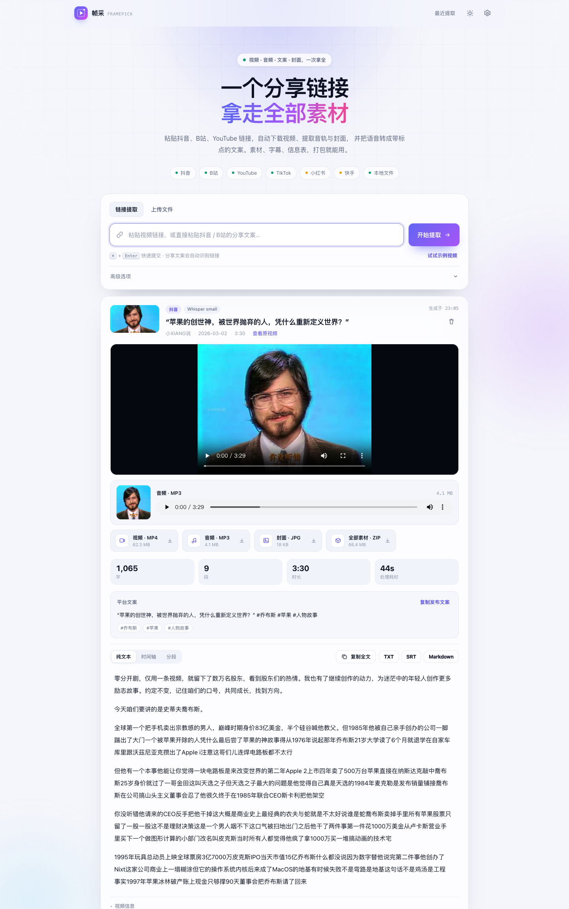

<p align="center">
  <picture>
    <source media="(prefers-color-scheme: dark)" srcset="docs/logo-dark.svg">
    
  </picture>
</p>

<h3 align="center">One link. Video, audio, cover and transcript.</h3>

<p align="center">
  Local-first. No login. Your media never leaves your machine.
</p>

<p align="center">
  <a href="LICENSE"></a>
  
  
  
  
</p>

<p align="center">
  
</p>

---

**FramePick（帧采）** turns a video share link into reusable assets: the video, its audio track, the cover image, the post caption, a transcript, and a metadata sheet. Everything runs locally: download, transcode, speech-to-text and export never hit a third-party API.

Douyin (抖音) and Xiaohongshu (小红书) are parsed through a local headless Chrome — the login modal is dismissed automatically, no scan and no cookies. Bilibili, YouTube, TikTok and most other sites go through yt-dlp. `rednote.com` links are mapped back to the Xiaohongshu origin before parsing. Local files work too.

> **Name**: 帧 (frame) + 采 (collect) — also sounds like “精彩” (wonderful). FramePick = pick what you need from a video.

## Features

- **No-login parsing** for Douyin and Xiaohongshu via headless Chrome; login overlays are closed automatically.
- **All assets**: MP4 video (720p / 1080p / original), MP3 audio, cover image, caption + hashtags, author/stats.
- **Local transcription**: platform subtitles first, otherwise ffmpeg + faster-whisper on your machine (MPS / CUDA / CPU).
- **Chinese-aware cleanup**: full-width punctuation, sentence splitting, duplicate removal, subtitle-sized chunks.
- **In-page playback**: video with seeking, audio player with cover art.
- **Exports**: TXT, timestamped TXT, SRT, Markdown, JSON, or a single ZIP with everything.
- **Task queue & history**: live progress, cancel, persisted results, shareable `/?task=<id>` links.
- **Optional cookies** are injected into the headless browser for restricted pages (e.g. RedNote-only notes).

## Quick start

Requirements: macOS or Linux, Python 3.10+, `ffmpeg`/`ffprobe`, and Google Chrome (for Douyin/Xiaohongshu).

```bash
git clone https://github.com/yuanlaiai/framepick.git
cd framepick

python3.13 -m venv .venv
source .venv/bin/activate
pip install -r requirements.txt
./run.sh                 # http://127.0.0.1:8790
```

The prebuilt frontend (`web/dist`) is committed, so Node is not needed to run. To work on the UI (Node 24+):

```bash
cd web
npm install
npm run dev      # http://127.0.0.1:5173, proxies /api to 8790
npm run build    # outputs web/dist
npm test         # Vitest
```

### Docker

```bash
docker compose up -d --build
# http://127.0.0.1:8790
```

The image includes ffmpeg and Chromium. Data, cookies and Whisper models live in `./data`; the first transcription downloads the model (~460 MB).

## Supported platforms

| Platform | Status | Notes |
| --- | --- | --- |
| Douyin (抖音) | ✅ | Anonymous headless Chrome, login modal auto-closed |
| Bilibili | ✅ | 1080p may require cookies |
| YouTube | ✅ | Platform subtitles preferred |
| TikTok | ✅ | Depends on region |
| Xiaohongshu (小红书) | ✅ | yt-dlp first, headless Chrome fallback; `xsec_token` links are more reliable |
| RedNote (rednote.com) | ⚠️ | Mapped to the Xiaohongshu origin; notes only available internationally need cookies |
| Kuaishou / WeChat Channels | ⚠️ | Experimental |
| Local files | ✅ | MP3 + cover frame generated automatically |

Image-only notes are not supported yet and return a clear message.

## How it works

```
Share link
   ├── yt-dlp ─────────────── Bilibili / YouTube / TikTok / Xiaohongshu ...
   └── Chrome + Playwright ── Douyin / Xiaohongshu (no login)
   ├── video: download / merge to H.264 MP4
   ├── audio: ffmpeg → MP3
   ├── cover: platform image, or a frame from the video
   └── transcript: platform subtitles → cleanup, or faster-whisper locally
```

Tech stack: FastAPI · yt-dlp · ffmpeg · faster-whisper · Playwright · React 19 · TypeScript · Vite 8 · Tailwind CSS 4.

## API

| Method | Path | Description |
| --- | --- | --- |
| POST | `/api/tasks` | Create a link task |
| POST | `/api/tasks/upload` | Upload a local file |
| GET | `/api/tasks/{id}` | Status + result |
| POST | `/api/tasks/{id}/cancel` | Cancel |
| DELETE | `/api/tasks/{id}` | Delete task and assets |
| GET | `/api/tasks/{id}/asset/{kind}` | `video` / `audio` / `cover` (`?download=1` to force download) |
| GET | `/api/tasks/{id}/package` | ZIP with all assets + transcript + SRT + metadata |
| GET | `/api/tasks/{id}/file?format=txt\|srt\|md\|timeline\|json` | Text exports |

## Development

- `ruff check app` and `python -m compileall -q app` for the backend.
- `cd web && npm test && npm run build` for the frontend.
- See [CONTRIBUTING.md](CONTRIBUTING.md) for project layout and how to add a platform.

## Disclaimer

This project is for personal study and backup. Respect platform terms and copyright; do not redistribute downloaded content without permission. The authors are not responsible for misuse.

## License

[MIT](LICENSE) © 2026 FramePick contributors

[简体中文](README.md)
