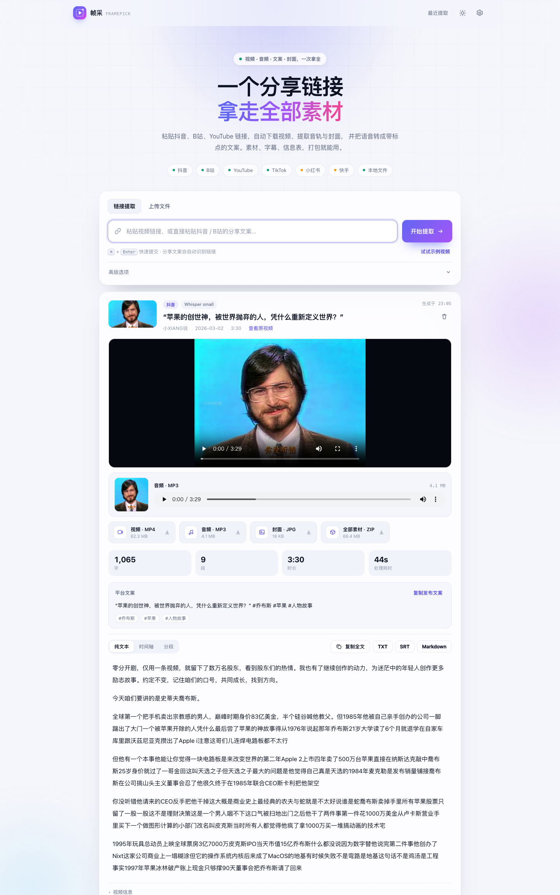
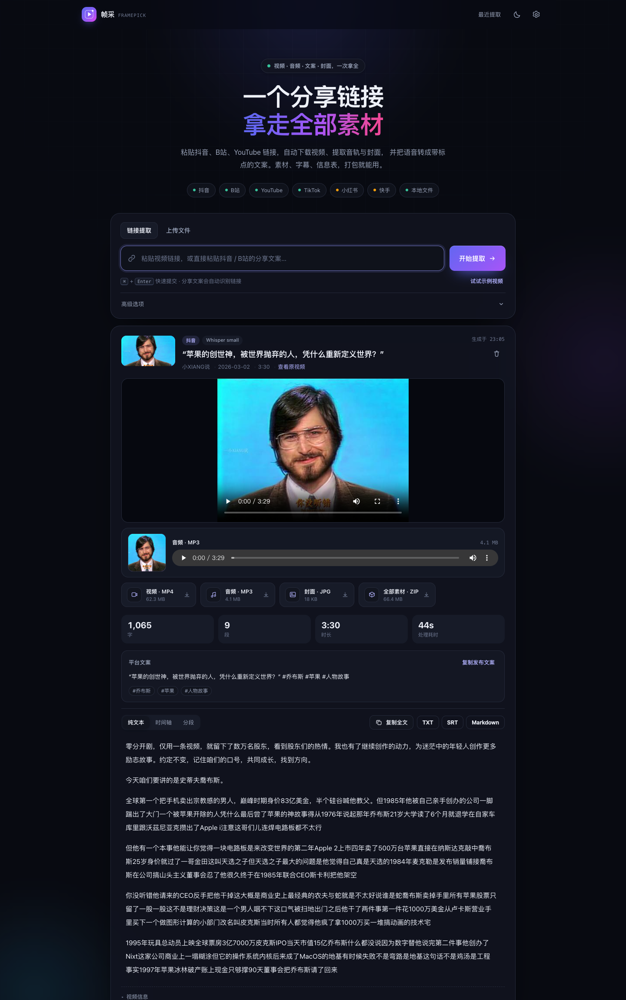
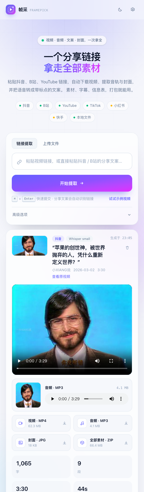

<p align="center">
  <picture>
    <source media="(prefers-color-scheme: dark)" srcset="docs/framepick-logo-dark.svg">
    
  </picture>
</p>

<h3 align="center">一个链接，取走视频、音频、封面和文案。</h3>

<p align="center">
  One link → video, audio, cover & transcript.<br/>
  Local-first. No login. Your media never leaves your machine.
</p>

<p align="center">
  <a href="https://github.com/yuanlaiai/framepick/actions/workflows/ci.yml"></a>
  <a href="https://github.com/yuanlaiai/framepick"></a>
</p>

<p align="center">
  <a href="README.en.md">English</a> · 简体中文
</p>

<p align="center">
  <a href="LICENSE"></a>
  
  
  
  
  
  
  
  
</p>

<p align="center">
  
</p>

---

**帧采**把一条视频分享链接拆成可以复用的素材：视频、音轨、封面、发布文案、语音转写，外加一份信息表。所有处理都在本机完成：下载、转码、逐句转写、导出，不经过第三方 API，也不需要账号。

抖音、小红书通过本机 Chrome 匿名解析——**登录弹窗会自动关掉，不用扫码**；B站、YouTube、TikTok 走 yt-dlp；RedNote（rednote.com）链接会自动映射回小红书主站。本地文件拖进去同样能出音频、封面和文字稿。

> **项目状态**：早期版本，接口和配置仍可能调整；遇到平台改版请提 Issue，欢迎 PR。

> **名字的由来**：帧 = 视频的每一帧，采 = 采集素材与文字；合起来读起来也像“精彩”。
> FramePick = 从一段视频里，取走你真正需要的东西。

## 目录

- [功能](#功能)
- [快速开始](#快速开始)
- [Docker 部署](#docker-部署)
- [使用](#使用)
- [支持平台](#支持平台)
- [工作原理](#工作原理)
- [API](#api)
- [配置](#配置)
- [常见问题](#常见问题)
- [路线图](#路线图)
- [参与贡献](#参与贡献)
- [免责声明](#免责声明)
- [License](#license)

## 功能

- **免登录解析**：抖音、小红书用本机 Chrome 打开分享页，读取页面自身的详情接口；登录弹窗自动关闭。
- **一套素材**：视频（H.264 MP4，可选 720p / 1080p / 原画）、音频（MP3）、封面（JPG/PNG，缺失时从视频截帧）、发布文案与话题标签、作者与互动数据。
- **本地转写**：平台有字幕就直接用；没有就 `ffmpeg` 解码 + `faster-whisper` 本机推理，Apple Silicon 走 MPS，约 7 倍实时。
- **中文优化**：自动补全中文标点、去掉字间空格、合并重复句、按语义断句分段，超长句自动拆成字幕级短句。
- **页面内播放**：视频进度条可拖动，音频有独立播放器并显示封面专辑图。
- **多种导出**：TXT、带时间轴 TXT、SRT、Markdown、JSON，或一键 ZIP 打包全部素材。
- **任务与历史**：实时进度、随时取消、结果持久化，支持 `/?task=<id>` 直接打开某条结果。
- **可选 Cookies**：遇到平台风控、1080P 权限限制时，导入浏览器 cookies 即可。
- **本地优先**：只监听 `127.0.0.1`，素材写入 `data/`，删除任务即清理缓存。

## 技术栈

| 层 | 选型 |
| --- | --- |
| 后端 | Python 3.10+ · FastAPI · yt-dlp · ffmpeg · faster-whisper |
| 免登录解析 | Playwright + 本机 Chrome（抖音 / 小红书） |
| 前端 | React 19 · TypeScript · Vite 8 · Tailwind CSS 4 |
| 测试 | Vitest · Testing Library（17 个用例） |
| 存储 | 本地 `data/`（任务 JSON + 素材文件），无数据库 |

| 暗色 | 移动端 |
| --- | --- |
|  |  |

## 快速开始

**环境要求**：macOS 或 Linux、Python 3.10+、`ffmpeg`（含 `ffprobe`）、Google Chrome（解析抖音/小红书用）。

```bash
# 1. 获取代码
git clone https://github.com/yuanlaiai/framepick.git
cd framepick

# 2. 创建虚拟环境并安装依赖
python3.13 -m venv .venv
source .venv/bin/activate          # Windows: .venv\Scripts\activate
pip install -r requirements.txt

# 3. 启动
./run.sh                            # 默认 http://127.0.0.1:8790
```

仓库已包含构建好的 `web/dist`，所以启动不需要 Node。改前端时再进 `web/`（Node 24+）：

```bash
cd web
npm install
npm run dev      # http://127.0.0.1:5173，/api 自动代理到 8790
npm run build    # 产出到 web/dist，FastAPI 直接托管
npm test         # Vitest 单元/组件测试
```

macOS 安装 ffmpeg：

```bash
brew install ffmpeg
```

更换端口：

```bash
PORT=8899 ./run.sh
```

首次转写会自动下载 Whisper 模型（`small` 约 460 MB）到 `~/.cache/framepick-models`；国内网络会自动切换到 `hf-mirror.com` 镜像，也可以用 `HF_ENDPOINT` 指定。

> Playwright 会直接使用系统已安装的 Chrome（`channel=chrome`），不需要额外执行 `playwright install`。如果 Chrome 不在默认路径，设置 `CHROME_BIN`。

## Docker 部署

镜像内已包含 ffmpeg、Chromium 和全部 Python 依赖，适合 NAS / 服务器长期运行：

```bash
docker compose up -d --build
# 打开 http://127.0.0.1:8790
```

说明：

- 素材、任务结果、cookies 和 Whisper 模型都放在 `./data`，容器重建不丢；
- 首次转写会自动下载模型（约 460 MB），建议预留 4 GB 以上内存；
- 抖音/小红书的免登录解析依赖镜像内的 Chromium，无需额外配置；
- 抖音在部分容器网络下会触发风控（详情接口返回空），此时在设置里导入 cookies 即可；B站 / YouTube / 本地文件不受影响；
- 改端口直接改 `docker-compose.yml` 的 `ports`，例如 `"8899:8790"`。

也可以手动构建：

```bash
docker build -t framepick .
docker run -d -p 8790:8790 -v "$PWD/data:/data" --name framepick framepick
```

## 使用

1. 粘贴视频链接，或直接粘贴抖音/B站的整段分享文案（会自动提取其中的 URL）；也可以上传本地音视频。
2. 按需展开「高级选项」：识别语言、模型档位、视频清晰度、是否下载素材、是否优先使用平台字幕。
3. 点「开始提取」，等待解析 → 下载 → 转写 → 排版完成。
4. 结果页可以：

   - 直接播放视频、拖动进度；音频用内置播放器播放（封面作为专辑图）；
   - 单独下载视频 / 音频 / 封面，或「全部素材」打包成 ZIP；
   - 复制平台发布文案，查看话题标签与作者数据；
   - 在纯文本 / 时间轴 / 分段三种视图间切换，导出 TXT / SRT / Markdown；
   - 展开「视频信息」查看分辨率、时长、体积、播放/点赞/评论等。

示例链接（公开视频）：

```
https://www.douyin.com/video/7612465013835468068
https://www.bilibili.com/video/BV1GJ411x7h7
https://www.youtube.com/watch?v=jNQXAC9IVRw
```

## 支持平台

| 平台 | 状态 | 说明 |
| --- | --- | --- |
| 抖音 | ✅ | Chrome 匿名解析，无需登录，登录弹窗自动关闭 |
| B站 | ✅ | 视频/音频/封面/文案；1080P 高码率可能需要 cookies |
| YouTube | ✅ | 优先平台字幕；网络不通时自动尝试系统代理 |
| TikTok | ✅ | 取决于所在地区网络 |
| 小红书 | ✅ | 优先走 yt-dlp，失败时用 Chrome 渲染；带 `xsec_token` 的链接更稳 |
| RedNote（rednote.com） | ⚠️ | 会自动映射到小红书主站；映射失败说明该笔记仅国际版可见，需要导入 cookies |
| 快手 / 视频号 | ⚠️ | 实验性，部分链接可能失败 |
| 本地文件 | ✅ | 最稳定，自动生成 MP3 与封面截帧 |

图文笔记（小红书图集）暂不支持，遇到会给出明确提示。RedNote 的登录页/404 也会转成可执行的中文提示，不再显示“暂不支持这个链接”。

## 工作原理

```
分享链接
   │
   ├── yt-dlp ─────────────── B站 / YouTube / TikTok / 其他
   └── Chrome + Playwright ── 抖音 / 小红书（免登录读接口）
   │
   ├── 视频：下载 / 合并为 H.264 MP4
   ├── 音频：ffmpeg 提取 MP3
   ├── 封面：平台封面，失败时从视频截帧
   └── 文案
        ├── 平台字幕 → 解析、去重、规整
        └── faster-whisper 本地转写（MPS / CUDA / CPU）
             └── 标点、断句、分段 → 文案 / SRT
```

目录结构：

```
framepick/
├── app/
│   ├── main.py        # FastAPI 路由、素材/打包下载、静态资源
│   ├── tasks.py       # 任务队列、状态与持久化
│   ├── pipeline.py    # 链接 → 素材 → 文案流水线
│   ├── scrapers.py    # 抖音 / 小红书免登录解析（Playwright + Chrome）
│   ├── asr.py         # ffmpeg 解码 + faster-whisper
│   ├── subtitles.py   # 平台字幕下载与 VTT/SRT/JSON3 解析
│   ├── textproc.py    # 标点、断句、分段、导出格式
│   ├── platforms.py   # 链接识别与平台判断
│   └── config.py      # 路径、模型、清晰度等配置
├── web/               # React 前端
│   ├── src/
│   │   ├── components/  # 页面区块与素材/播放器组件
│   │   ├── hooks/       # 主题、Toast、任务轮询状态机
│   │   ├── lib/         # API 封装、格式化、剪贴板
│   │   ├── types.ts     # 与后端 API 对齐的类型
│   │   └── App.tsx
│   ├── src/test/        # Vitest 配置、样例数据与测试
│   ├── public/          # logo 等静态资源
│   └── dist/            # 构建产物（已提交，FastAPI 托管）
├── docs/              # Logo 与截图
├── data/              # 运行数据（素材、任务结果、cookies）
├── run.sh
└── requirements.txt
```

## API

REST 接口，默认监听 `127.0.0.1:8790`。

| 方法 | 路径 | 说明 |
| --- | --- | --- |
| POST | `/api/tasks` | `{url, model, language, prefer_subtitles, download_media, quality}` 创建链接任务 |
| POST | `/api/tasks/upload` | multipart 上传文件创建任务 |
| GET | `/api/tasks/{id}` | 查询状态与结果（含 `assets`） |
| POST | `/api/tasks/{id}/cancel` | 取消任务 |
| DELETE | `/api/tasks/{id}` | 删除任务、素材与缓存 |
| GET | `/api/tasks/{id}/asset/{video\|audio\|cover}` | 获取单个素材（支持 Range，可在线播放；加 `?download=1` 强制下载） |
| GET | `/api/tasks/{id}/package` | 打包下载全部素材 + 文案 + 字幕 + 信息表 |
| GET | `/api/tasks/{id}/file?format=txt\|srt\|md\|timeline\|json` | 下载文本类导出 |
| GET | `/api/tasks?limit=12` | 最近任务 |
| GET/POST/DELETE | `/api/settings/cookies` | 读取状态 / 保存 / 清除 cookies |

创建任务示例：

```bash
curl -X POST http://127.0.0.1:8790/api/tasks \
  -H 'Content-Type: application/json' \
  -d '{"url":"https://www.bilibili.com/video/BV1GJ411x7h7","model":"standard","quality":"720"}'
```

## 配置

| 环境变量 | 默认值 | 说明 |
| --- | --- | --- |
| `PORT` | `8790` | 服务端口 |
| `FRAMEPICK_DATA_DIR` | `./data` | 运行数据目录 |
| `FRAMEPICK_MODEL_DIR` | `~/.cache/framepick-models` | Whisper 模型缓存 |
| `FRAMEPICK_MAX_UPLOAD_MB` | `600` | 上传大小上限 |
| `HF_ENDPOINT` | 自动探测 | HuggingFace 模型下载地址 |
| `CHROME_BIN` | 自动查找 | Chrome / Chromium 可执行文件路径 |
| `FFMPEG_BIN` / `FFPROBE_BIN` | 自动查找 | 指定 ffmpeg 路径 |

模型档位：

| 档位 | 模型 | 适用场景 |
| --- | --- | --- |
| 极速 | base | 短视频、快速预览 |
| 标准 | small | 默认，速度与准确度平衡 |
| 精准 | medium | 长视频、专业内容，首次下载约 1.5 GB |

## 常见问题

**需要登录或 cookies 吗？**
抖音、小红书不需要，程序用本机 Chrome 匿名访问并自动关掉登录弹窗；B站/YouTube 绝大部分视频也不需要。只有遇到平台风控、会员视频、1080P 权限限制时才需要导入 cookies。

**为什么第一次转写很慢？**
首次使用要下载 Whisper 模型。下载完成后，Apple Silicon 上 `small` 模型约 7 倍实时。

**抖音提示“Fresh cookies ... needed”？**
这是 yt-dlp 的限制；本项目已绕开 yt-dlp，改用 Chrome 读取页面接口，无需 cookies。

**小红书 / RedNote 解析失败？**
- `rednote.com` 链接会自动换成 `xiaohongshu.com/explore/{id}` 再解析；如果该笔记只在国际版可见，就会落到登录页，需要导入 cookies；
- 小红书分享链接的 `xsec_token` 有时效，过期后请重新从 App 分享；
- 只贴 `/explore/{id}` 且页面提示不可访问时，请使用 App 里的完整分享文案。

**导入的 cookies 会被用在哪里？**
抖音/小红书的无头浏览器会自动带上你在设置里导入的 cookies；所以 RedNote 登录态、B站会员视频等场景也能复用同一份 cookies。

**视频下载失败但文案成功？**
部分平台限制视频流（登录 / 会员 / DRM），此时仍可拿到音频与文案；可切换清晰度或导入 cookies 重试。

**纯音乐或演唱视频识别不出？**
人声检测（VAD）会把连续演唱判成非语音，程序会自动改用整段转写重试一次。

**磁盘占用太大？**
素材保存在 `data/assets/<任务 id>/`，删除对应记录即可一并清理。

**改了前端代码但页面没变化？**
前端不是热更新到 8790 的：开发时用 `cd web && npm run dev`（5173 端口，带代理）；改完要发布就 `npm run build`，然后刷新 8790。

**Docker 里抖音解析失败？**
先确认容器内 Chromium 可用：`docker compose exec framepick chromium --version`。若平台要求验证，仍可在设置里导入 cookies。

**支持 Windows 吗？**
代码未针对 Windows 做适配与测试，理论上可用（需要 ffmpeg 与 Chrome），欢迎提交 PR。

## 路线图

- [x] 抖音 / 小红书免登录解析
- [x] 视频 / 音频 / 封面 / 文案 / 信息表一体导出
- [x] 页面内视频与音频播放、封面展示
- [ ] 小红书图文笔记（图集下载）
- [ ] 批量链接 / 队列导入
- [ ] AI 摘要与文案改写
- [ ] 字幕翻译（双语 SRT）
- [x] Docker 镜像（桌面端打包仍在计划中）
- [ ] Windows 适配

## 参与贡献

欢迎 Issue 与 PR！请先阅读 [CONTRIBUTING.md](CONTRIBUTING.md)。

- 报告问题：请附上平台、链接类型（可脱敏）、错误信息和运行环境。
- 新增平台：在 `app/scrapers.py` 或 yt-dlp 支持范围内实现，并补充测试。
- 提交前请确保 `python -m compileall app` 通过，并手动回归 B站/抖音/本地文件三条链路。

## 免责声明

本项目仅供个人学习、研究与自用备份，**请勿用于侵犯版权、批量搬运或商业分发**。

- 下载内容的版权归原作者与平台所有，请在授权范围内使用；
- 使用本项目即表示你同意遵守各平台的服务条款与当地法律法规；
- 项目不提供任何内容托管或分发能力，作者不对使用者的行为承担责任；
- 平台接口与风控策略随时可能变化，解析功能不保证长期可用。

## License

[MIT](LICENSE) © 2026 FramePick contributors

## 致谢

- [yt-dlp](https://github.com/yt-dlp/yt-dlp) — 链接解析与音视频下载
- [faster-whisper](https://github.com/SYSTRAN/faster-whisper) — 本地语音识别
- [FastAPI](https://fastapi.tiangolo.com/) — Web 服务
- [Playwright](https://playwright.dev/python/) — 无头浏览器驱动
- [FFmpeg](https://ffmpeg.org/) — 转码与截帧

<p align="center"><sub>如果这个项目帮到了你，欢迎点一个 ⭐</sub></p>
